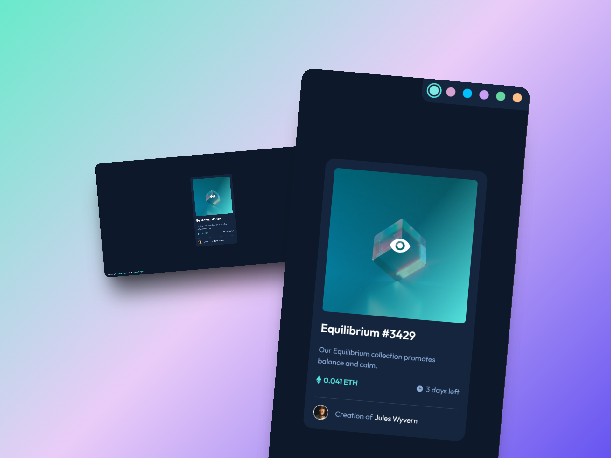

# Frontend Mentor - NFT preview card component solution

This is a solution to the [NFT preview card component challenge on Frontend Mentor](https://www.frontendmentor.io/challenges/nft-preview-card-component-SbdUL_w0U). Frontend Mentor challenges help you improve your coding skills by building realistic projects. 

## Overview

### Features
- Responsive layout for different screen sizes
- Interactive hover states
- Customizable color accent theme switcher with six options

### Screenshot




### Links

- Solution URL: [Frontend Mentor](https://www.frontendmentor.io/solutions/nft-preview-card-component-using-html-css-and-javascript-4H7Mb5mMis)
- Live Site URL: [GitHub Pages](https://rebeccadoesweb.github.io/nft-preview-card-component/)

## My process

### Built with

- HTML
- CSS (Flexbox, Grid, custom properties)
- JavaScript


### What I learned
I used [tldraw](https://www.tldraw.com/) to plan out the layout of the card and  [Figma](https://www.figma.com/) to refine the design.


Accessibility was a key focus. I used Firefox DevTools' Accessibility panel to check color contrast and adjust color for better readability.

I also used CSS custom properties to manage accent colors and create a gradient overlay:


```css
.card__banner::after {
  background: linear-gradient(125deg,
      var(--accent-bkg),
      var(--accent-light),
      var(--accent));
}
```

To add a personal touch, I created a theme switcher with six color options: cyan, pink, blue, purple, green, and orange.

### AI Collaboration

I used ChatGPT to brainstorm design ideas, which helped inspire the color accent theme switcher.

## Author

- Frontend Mentor - [@rebeccadoesweb](https://www.frontendmentor.io/profile/rebeccadoesweb)
- GitHub - [@rebeccadoesweb](https://github.com/rebeccadoesweb)
- LinkedIn - [@rebecca-web-dev](https://www.linkedin.com/in/rebecca-web-dev/)


## Acknowledgments

- Google Font Helper - [Google Fonts Helper](https://gwfh.mranftl.com/fonts) - Font imports
- Shots - [https://shots.so/](https://shots.so/) - Project mockups

## Contributing

Contributions, feature ideas, and feedback are welcome! Feel free to fork the project and submit a pull request.